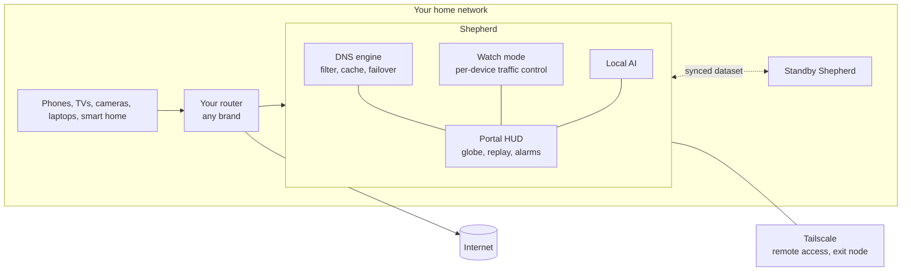

<p align="center">
  
</p>

<h1 align="center">Shepherd</h1>

<p align="center">
  <b>The guardian your home network never had.</b><br>
  Open source. Self-hosted. Sees everything on your network. Tells nobody.
</p>

<p align="center">
  <a href="https://github.com/blaineam/shepherd/actions/workflows/ci.yml"></a>
  <a href="LICENSE"></a>
  <a href="https://github.com/blaineam/shepherd/releases"></a>
  
</p>

---

## Your network is a flock. Right now you can't see it.

Every phone, TV, camera, thermostat, laptop and light bulb in your home is quietly talking to
servers around the world. Most of it is harmless. Some of it is tracking you. A little of it, one day,
will be an attacker, or a device that has gone bad.

The tools that can show you this are either closed hardware you rent forever, or a pile of
dashboards you have to babysit, none of which talk to each other.

**Shepherd is one app that watches the whole flock.** It runs on a NAS, a mini PC, a Mac or a Windows
box *inside* your network. No new router. No cloud. No subscription. It learns who your devices
are, what they talk to, and notices the black sheep: the device that does not belong.

## The vision

**See it.** An interactive 3D globe lights up in real time. Every connection is an arc that wraps around
the planet from the device that made it to the place it is talking to. Heavy transfers are thick and
bright, tiny lookups are hairlines. Scrub a timeline to replay last Tuesday at 3 a.m.

**Control it.** Click an arc, a device or a country to block, pause, rate-limit or quarantine, live, with undo.
Group devices into "Kids", "IoT" or "Work" and every rule, chart and alarm follows the group.

**Trust it.** Ads, trackers and known-bad domains are blocked at the network level for every device,
including the ones that cannot run an ad blocker. Anything unusual raises an alarm you can mute, snooze
and manage in bulk, so you hear about the things that matter and only those.

**Survive anything.** Run more than one Shepherd. They form a mesh that shares one dataset: rules, devices,
alarms and history. A spare box takes over in seconds when the main one goes down.

**Think locally.** A local AI learns what normal looks like for each device and explains what is
strange, in plain English, without a byte leaving your house.

**Reach it anywhere.** Built on Tailscale, so your phone gets the same protection on cellular, and you can
reach any device at home securely from anywhere.

## What works today

Shepherd is early and built in public. This is real, tested and running on a real network:

- [x] **One native binary** for Linux, macOS and Windows. No Docker, no database server, no dependencies.
- [x] **DNS filtering engine** with blocklists, allow and block rules, a cache, and IPv4 and IPv6 over UDP and TCP.
- [x] **Self-healing upstreams.** Continuous health probing and instant failover. Born from a real outage, so it never stalls your network on a dead resolver.
- [x] **Guarded blocklist updates.** A broken or hostile list is rejected and the last good one stays active.
- [x] **Apple iCloud Private Relay blocking**, the way Apple documents for networks, with every attempt logged by device.
- [x] **Protected out of the box.** A blocklist and the Private Relay policy are on by default; opt out of either in the config or the portal.
- [x] **Live portal** with per-device queries, one-click allow and block, upstream health, rules and policy switches.
- [x] **Tailscale integration** for private remote access, validated on a live exit node and subnet router.
- [x] **Thread, Matter and IPv6 safe by design**, written down as hard rules ([IPV6.md](docs/IPV6.md)).
- [x] **97% test coverage** with the race detector, enforced by a floor that only rises.

What is coming, in order: devices and alarms, the mesh, signed self-updates, per-device traffic
control, **the globe**, replay, scans and threat feeds, the local AI, and one-click installers.
See the [roadmap](docs/ROADMAP.md).

## How it fits together



- **Guard**: your router hands out Shepherd as DNS, so every device is filtered the moment setup finishes. It cannot take your internet down.
- **Watch** (on by default once enabled, opt out per device): Shepherd steers devices through itself for bytes, flows,
  geo-blocking and real pause. IPv4 only, never touching IPv6, Thread or Matter. Infrastructure is excluded automatically.
- Works with routers that offer nothing, like eero, because it needs no router integration.

## Principles

- **Private by design.** No telemetry. No accounts. Query history lives in memory. The only outbound
  connections are your DNS upstreams and blocklist downloads.
- **Never breaks your smart home.** IPv6, Thread, Matter and mDNS are protected by rules in the code, not by luck.
- **Free and keyless.** No paid APIs. Every data source works without an account.
- **Self-maintaining.** Lists, upstreams and storage look after themselves, with guardrails and rollback.
- **Protected by default.** Set it up once and every device is covered. You opt out per device or feature, never opt in. Staged rollout, a fail-open watchdog and automatic exclusion of infrastructure keep that safe.
- **Open and honest.** AGPL, built in public, tested first. This README says what works and what does not.

## Try it

Grab the newest beta from [Releases](https://github.com/blaineam/shepherd/releases), or build it:

```bash
git clone https://github.com/blaineam/shepherd && cd shepherd
make build
cp shepherd.example.toml shepherd.toml      # set dns.listen and portal.listen
bin/shepherd -config shepherd.toml
```

Run it on a spare port beside your current resolver, check it with `dig`, and only then point your
router at it. The [Wave 2 guide](docs/WAVE-2.md) walks through it and what to verify.

## Built in public, without leaking your network

Shepherd is developed on a real home network, in the open. A leak guard blocks private addresses,
MAC addresses, tailnet names, keys and personal details from every commit and commit message, locally
and in CI. Tests run against fakes on loopback, never a real network. Docs, changelog and code move
together, enforced by a check. See [PUBLIC-DEV.md](docs/PUBLIC-DEV.md).

## Contribute

Tests first, coverage only goes up, and nothing real leaves your network. Start with
[CONTRIBUTING.md](CONTRIBUTING.md) and the [Code of Conduct](CODE_OF_CONDUCT.md). Report security issues
privately through [SECURITY.md](SECURITY.md). Releases follow [SemVer](https://semver.org/) with a
[changelog](CHANGELOG.md); every push to `main` produces one rolling beta ([RELEASING.md](docs/RELEASING.md)).

## Docs

[Design](docs/DESIGN.md) · [Roadmap](docs/ROADMAP.md) · [Testing](docs/TESTING.md) · [IPv6 and Thread](docs/IPV6.md) ·
[Wave 2 guide](docs/WAVE-2.md) · [Releasing](docs/RELEASING.md) · [Public development](docs/PUBLIC-DEV.md)

## License

AGPL-3.0-or-later. If you run a modified Shepherd as a service, you share your changes. See [LICENSE](LICENSE).
